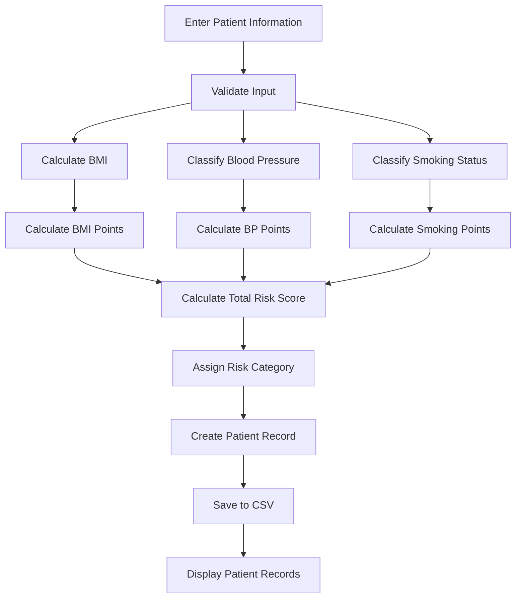

# 🩺 Clinical Risk Assessment Tool

<p align="center">
  <strong>A Python-based patient risk assessment project built with CS50P</strong><br>
  Input validation • Clinical calculations • Risk scoring • CSV records • Automated testing
</p>

<p align="center">
  
  
  
  
  
</p>

<p align="center">
  <a href="https://youtu.be/kwwScs0isIk">
    
  </a>
</p>

<p align="center">
  <strong>▶️ Watch the Project Demo</strong>
</p>
---

## 📌 Overview

The **Clinical Risk Assessment Tool** is a command-line Python application developed as my **CS50's Introduction to Programming with Python (CS50P) final project**.

The application accepts basic patient information, performs several health-related calculations and classifications, produces a simplified project-defined risk score, and stores patient records in a CSV file.

The project was designed to combine programming fundamentals with a healthcare-oriented use case while keeping the implementation transparent and understandable.

> ⚠️ **Important:** This is an educational programming project. The risk score is a simplified, project-defined scoring model and has **not been clinically validated**. It must not be used for diagnosis, treatment decisions, or real-world clinical risk assessment.

---

## Features

- 👤 Patient information collection
- 📏 BMI calculation
- ⚖️ BMI categorization
- 📟 Blood-pressure categorization
- 🚬 Smoking-status categorization
- 🧮 Risk-point calculation
- 📊 Overall risk classification
- 💾 Persistent patient records using CSV
- 📋 Patient-record display using `tabulate`
- 🛡️ Input validation and error handling
- 🧪 Automated testing with `pytest`
- 🧩 Modular code separated into application and scoring logic

---

## Example

### Example Input

```text
Name: John
Age: 45
Gender: Male
Blood pressure: 145/95
Height (m): 1.75
Weight (kg): 90
Smoking status: YES
```

### Example Assessment

```text
Patient Risk Assessment
Name: John
Age: 45
Gender: Male
BMI: 29.39
BMI category: overweight
Blood pressure: 145/95
BP category: Stage 2
Smoking status: Smoker
Total risk points: 5
Risk: High risk
```

### Calculation

| Component | Result | Points |
|---|---|---:|
| BMI | 29.39 (Overweight) | 1 |
| Blood Pressure | 145/95  (Stage 2) | 3 |
| Smoking | Smoker | 1 |
| **Total** | | **5** |
| **Risk** | | **High risk** |

---

## How It Works



The application follows a straightforward pipeline:

**Input → Validation → Classification → Scoring → Risk Assessment → Storage → Display**

---

## 🧮 Risk Scoring Model

The scoring model is intentionally simple and transparent.

### BMI

| BMI Category | Points |
|---|---:|
| Normal weight | 0 |
| Overweight | 1 |
| Obese | 2 |

> Underweight is recorded as a category but currently contributes 0 points.

### Blood Pressure

| Category | Points |
|---|---:|
| Normal | 0 |
| Elevated | 1 |
| Stage 1 | 2 |
| Stage 2 | 3 |
| Crisis | 4 |

### Smoking

| Status | Points |
|---|---:|
| Non-smoker | 0 |
| Smoker | 1 |

### Overall Risk

| Total Points | Risk Category |
|---:|---|
| 0–1 | Low risk |
| 2–3 | Moderate risk |
| 4–5 | High risk |
| 6+ | Very high risk |


---

## Testing

Testing is performed using **pytest**, which covers:

- BMI categories
- Blood-pressure categories
- Smoking classification
- BMI scoring
- Blood-pressure scoring
- Smoking scoring
- Overall risk categories
- Invalid patient input
- Repeated input after invalid values
- Blood-pressure input parsing

Run the complete test  with:

```bash
pytest
```

A successful run should report that all tests pass.

---

## 📁 Project Structure

```text
clinical-risk-assessment/
│
├── project.py
│   └── Main application logic
│
├── scores.py
│   └── Risk-scoring functions
│
├── test_project.py
│   └── Automated tests
│
├── patient_record.csv
│   └── Saved patient records
│
├── requirements.txt
│   └── Third-party dependencies
│
└── README.md
    └── Project documentation
```

### `project.py`

Responsible for:

- Patient input
- Input validation
- BMI calculation
- Blood-pressure classification
- Smoking classification
- Patient-record creation
- CSV storage
- Patient-record display

### `scores.py`

Contains the scoring logic:

```text
BMI category → BMI points
BP category → BP points
Smoking status → smoking points
Total points → risk category
```

Keeping the scoring logic separate makes the application easier to understand, maintain, and test.

### `test_project.py`

Contains automated tests for the application's functions and validation behavior.

---

## Technologies

| Technology | Purpose |
|---|---|
| **Python 3** | Core programming language |
| `csv` | Patient-record storage |
| `os` | File-existence checking |
| `tabulate` | Formatted table output |
| `pytest` | Automated testing |

---

## Installation

Clone the repository and enter the project directory:

```bash
git clone <your-repository-url>
cd clinical-risk-assessment
```

Install the required dependency:

```bash
pip install -r requirements.txt
```

---

## Running the Application

Run:

```bash
python project.py
```

The application will prompt you for patient information and generate an assessment.

Patient records are stored in:

```text
patient_record.csv
```

> When publishing this project, use fictional/example patient data. Do not commit real patient information to a public repository.

---

## 🧩 Example Data Flow

A patient's information is transformed through several stages:

```text
Patient Input
     │
     ▼
Validation
     │
     ├──────────────┐
     ▼              ▼
BMI Calculation   BP Classification
     │              │
     ▼              ▼
BMI Points        BP Points
     │              │
     └──────┬───────┘
            │
     Smoking Points
            │
            ▼
      Total Score
            │
            ▼
     Risk Category
            │
            ▼
      Patient Record
            │
            ▼
        CSV File
```

---

## 🔐 Data and Privacy

The application stores patient records locally in a CSV file.

For a public GitHub repository:

- Do not use real patient information.
- Use fictional names and values for demonstrations.
- Consider adding the generated CSV to `.gitignore` if it contains locally entered data.
- Never commit sensitive healthcare information.

Example `.gitignore` entry:

```gitignore
patient_record.csv
__pycache__/
.pytest_cache/
```

---

## 🚧 Limitations

This project is intentionally limited in scope.

It does **not**:

- Use a validated clinical risk calculator
- Diagnose medical conditions
- Recommend treatment
- Predict individual patient outcomes
- Use machine learning
- Connect to an electronic health record
- Implement FHIR or other healthcare interoperability standards
- Replace professional clinical judgment

The purpose is to demonstrate Python programming through a healthcare-oriented application.

---

## 📚 Learning Resources

For editing and previewing this README in Visual Studio Code, VS Code supports Markdown preview natively. You can open the preview with:

```text
⌘ + Shift + V
```

or open the Markdown preview to the side with:

```text
⌘ + K, V
```


---

## Project Goal

The goal of this project is to demonstrate how fundamental Python programming concepts can be combined into a complete, structured application with a practical healthcare-oriented use case.

The project emphasizes:

> **Clean code • Validation • Modularity • Testing • Data handling • Interpretability**

---

## Author

**Saba Bagdavadze, CS50P Final Project**

Clinical Risk Assessment Tool

---

